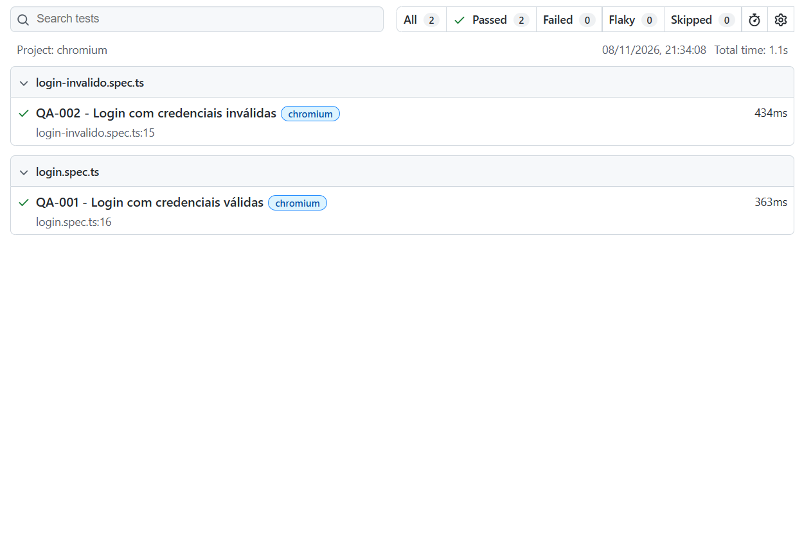

# QA Automation Protheus

Portfólio de automação de testes de ERP com Playwright e TypeScript, utilizando cenários inspirados no TOTVS Protheus.

## Sobre o projeto

Este projeto demonstra testes automatizados em um ERP Simulado, desenvolvido em HTML para fins de estudo e portfólio.

Os testes são inspirados em processos de sistemas ERP, sem utilizar uma instalação real do TOTVS Protheus.

## Tecnologias utilizadas

- Playwright
- TypeScript
- Node.js
- Visual Studio Code
- Git e GitHub

## Cenários automatizados

| ID | Cenário | Resultado |
|---|---|---|
| QA-001 | Login com credenciais válidas | Aprovado |
| QA-002 | Login com credenciais inválidas | Aprovado |

## Como executar os testes

Instale as dependências:

```bash
npm install
npx playwright install chromium
```

Execute todos os testes:

```bash
npx playwright test
```

Visualize o relatório:

```bash
npx playwright show-report
```

## Evidências



## Próximos passos

- Ampliar os cenários de autenticação
- Implementar testes de funcionalidades de ERP
- Organizar os testes por módulos
- Integrar a execução automatizada ao GitHub Actions
